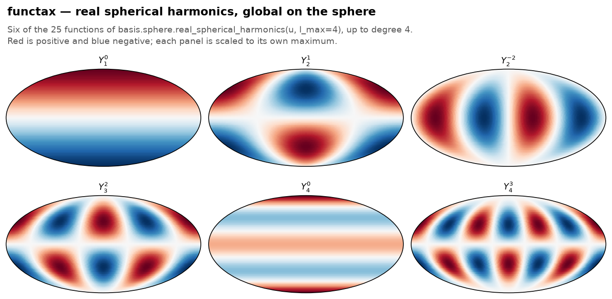
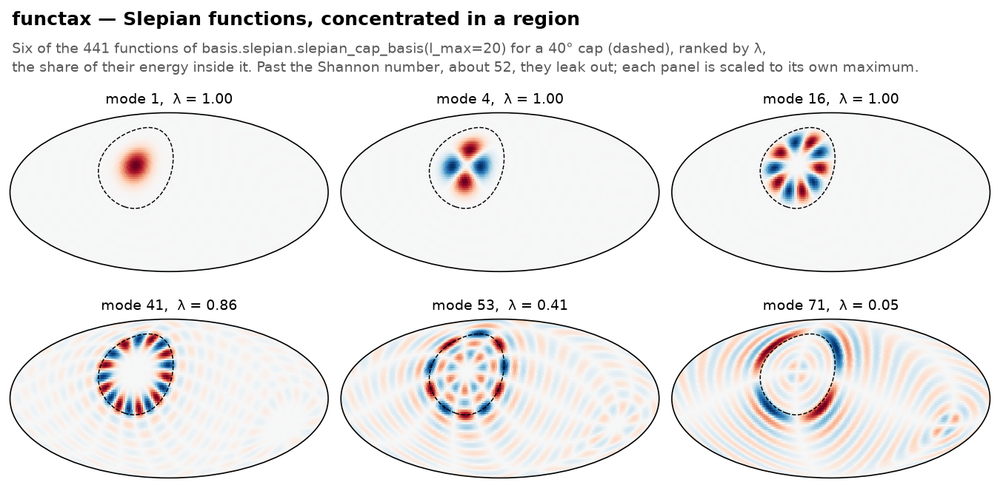
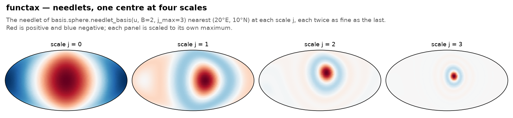

<div align="center">

<picture>
  <source media="(prefers-color-scheme: dark)" srcset="docs/assets/logo-dark.svg">
  
</picture>

**Function approximation for JAX: bases, interpolation plans with adjoints, quadrature rules and transforms, on Equinox, lineax and einx.**

[](https://github.com/jejjohnson/functax/actions/workflows/ci.yml)
[](https://github.com/jejjohnson/functax/actions/workflows/lint.yml)
[](https://github.com/jejjohnson/functax/actions/workflows/typecheck.yml)
[](https://jejjohnson.github.io/functax/)
[](https://codecov.io/gh/jejjohnson/functax)
[](https://www.python.org/)
[](LICENSE)
[](https://github.com/astral-sh/ruff)
[](https://github.com/astral-sh/uv)
[](https://github.com/pre-commit/pre-commit)

📖 [Documentation](https://jejjohnson.github.io/functax/) ·
🚀 [Quickstart](https://jejjohnson.github.io/functax/quickstart/) ·
🛰️ [Methane example](https://jejjohnson.github.io/functax/methane/) ·
📚 [API reference](https://jejjohnson.github.io/functax/reference/) ·
🧭 [Design](https://github.com/jejjohnson/geostack/blob/main/docs/design/libraries/functax.md)

</div>

---

A field in the geosciences arrives as samples: pixels of a swath, nodes of a grid, scattered stations. Yet most of what we do with it treats it as a function, which we read at other points, differentiate, integrate, fit to data and change into another basis. So functax treats a field as a function (which is also where the name comes from, as the section on the name below says) and writes it as one expansion,

```math
x(\mathbf{s}) \approx \sum_{d=1}^{D_z} z_d \phi_d(\mathbf{s}; \boldsymbol{\theta})
```

where $`\mathbf{s} \in \Omega`$ are the coordinates, $`\phi_d`$ are the basis functions with parameters $`\boldsymbol{\theta}`$ and $`\mathbf{z} \in \mathbb{R}^{D_z}`$ are the coefficients. On $`N`$ points $`\mathbf{s}_n`$ this becomes $`\mathbf{x} = \boldsymbol{\Phi} \mathbf{z}`$, with $`\mathbf{x} \in \mathbb{R}^N`$ and the basis matrix $`\boldsymbol{\Phi} \in \mathbb{R}^{N \times D_z}`$, $`[\boldsymbol{\Phi}]_{nd} = \phi_d(\mathbf{s}_n)`$. Almost everything in the library is one of five operations on this expansion.

```python
# Shapes: N_Ωy points; D_z basis functions; N_Ωx grid pixels; N_* targets
# (design, observations, grid, targets and field as in the quickstart below)

# today (functax)
# ẑ = argmin_z ‖Φz − y‖²
coefficients = least_squares(design, observations)  # → (D_z,)
# today (functax)
# H, the read-out from the grid to the targets
plan = Linear().plan(grid, targets)  # (N_*, N_Ωx) operator
# y_* = H x
values = plan(field)  # (N_Ωx,) → (N_*,)
# Hᵀ r, the residuals sent back to the grid
back = plan.adjoint(residuals)  # (N_*,) → (N_Ωx,)
```

None of it is a new framework. Building a plan or a rule may run on the host with NumPy, but applying it is pure [JAX](https://github.com/jax-ml/jax), so `jit`, `vmap` and `grad` go through every plan, rule and transform. Plans, rules and transforms are [Equinox](https://github.com/patrick-kidger/equinox) modules, contractions are [einx](https://github.com/fferflo/einx) expressions, and the variational fit solves with a [lineax](https://github.com/patrick-kidger/lineax) solver. We also leave models out of functax, so that it can sit at the bottom of the stack: a kernel comes in as a callable, a solver as a lineax operator and a difference operator as an argument.

<p align="center"></p>

## 🌟 Highlights

- 🧮 **Interpolation plans with adjoints**: 17 schemes, from `Nearest` and `BSpline` to `Delaunay`, `Conservative`, `RBF` and `Kriging`, each frozen into a `Plan` that applies a read-out $`\mathbf{H}`$ and, for every scheme whose fit is linear in the data, its adjoint $`\mathbf{H}^\top`$. Plans compose (`outer @ inner`), cut to a window of a grid target (`plan[window]`) and export their stencil for gaussx (`plan.to_gaussx()`).
- 🌍 **Bases on the sphere and the plane**: real and vector spherical harmonics, needlets, Slepian functions of caps, polar gaps and regions, Fourier, RBF, Wendland, Gabor and wavelet bases, EOFs and Laplacian eigenpairs, Legendre polynomials, divergence-free and curl-free atoms, and random Fourier and seasonal features.
- 📏 **Quadrature rules as data**: Gauss–Legendre, Clenshaw–Curtis, trapezoid and Simpson rules, four rules on the sphere (Gauss–Legendre, lat-lon, HEALPix, Fibonacci), cell areas and polylines, which integrix sums.
- 🔁 **Transforms**: spherical-harmonic and needlet-wavelet analysis and synthesis, the nonuniform real FFT and Chebyshev transforms in one and two dimensions.
- 📐 **Projection and gap filling**: ridge least squares, Galerkin projection with a rule's weights, a matrix-free variational fit solved by lineax CG, and Laplace and biharmonic gap fills.
- 🧭 **Geometry without a CRS**: axes, affine, rectilinear and curvilinear grids, point sets, sphere grids and local frames, with the affine raster kernels in a NumPy-only base install.
- ✅ **Tested against SciPy**: SciPy is the oracle every interpolation scheme is tested against.

## 📐 One expansion, five operations

Each operation has its own module, and each reads or writes the expansion above. Here $`\mathbf{y}`$ are data at the observation points, $`\mathbf{H}`$ is a plan's read-out from the source points to the targets, $`\mathbf{r}`$ are residuals at the targets and $`w_n`$ are a rule's weights.

| Operation | Equation | Module | Main names |
|---|---|---|---|
| Interpolate | $`\mathbf{y} = \mathbf{H} \mathbf{x}`$, and $`\mathbf{H}^\top \mathbf{r}`$ back | `functax.interp` | `Plan`, `Linear`, `Cubic`, `BSpline`, `Conservative`, `RBF`, `Kriging` |
| Differentiate | $`\nabla x`$, $`\nabla \cdot \mathbf{u}`$, $`\nabla^2 x`$, and $`\nabla_S x`$, $`\Delta_S x`$ on the sphere | `functax.diffops` | `gradient`, `divergence`, `laplacian`, `surface_grad`, `laplace_beltrami` |
| Integrate | $`\int_\Omega x(\mathbf{s}) \mathrm{d}\mathbf{s} \approx \sum_n w_n x(\mathbf{s}_n)`$ | `functax.quad` | `Rule`, `gauss_legendre`, `clenshaw_curtis`, `SphereRule`, `cell_area` |
| Project | $`\hat{\mathbf{z}} = \mathrm{argmin}_{\mathbf{z}} \Vert \boldsymbol{\Phi} \mathbf{z} - \mathbf{y} \Vert^2 + \alpha \Vert \mathbf{z} \Vert^2`$ | `functax.project` | `least_squares`, `galerkin`, `Variational`, `fill_gaps` |
| Transform | $`\mathbf{x} = \boldsymbol{\Phi} \mathbf{z}`$ and $`\mathbf{z} = \boldsymbol{\Phi}^\top \mathbf{W} \mathbf{x}`$ | `functax.transform` | `SphericalHarmonicTransform`, `SphericalWaveletTransform`, `nonuniform_rfft`, `ChebyshevTransform1D` |

A plan first fits the samples and then reads the fit out, so it applies $`\mathbf{H} \mathcal{S}(\mathbf{x})`$ with a fit $`\mathcal{S}`$ and, when $`\mathcal{S}`$ is linear, its adjoint is $`\mathcal{S}^\top \mathbf{H}^\top`$. For `Nearest`, `Linear` and `Cubic` the fit is the identity, while `BSpline` prefilters and `RBF` and `Kriging` solve a kernel system. `Pchip`, `Akima` and `Steffen` fit slopes that depend on the data, so their plans have no fixed adjoint, and `plan.linearize(y)` gives one at $`\mathbf{y}`$. Derivatives are taken by autodiff of the expansion at one point, while derivatives on grids belong to gridax, finitevolX and spectraldiffx. The transform's analysis line is the spherical-harmonic one, where $`\mathbf{W}`$ holds the weights of a quadrature rule on the grid. The [guides](https://jejjohnson.github.io/functax/) derive each of these and say where they stop holding.

## 📥 Install

functax is not on PyPI yet, so install it from GitHub with [uv](https://docs.astral.sh/uv/). It needs Python 3.12 or newer.

```bash
uv add "functax @ git+https://github.com/jejjohnson/functax.git"
```

The base install depends on NumPy alone and holds the affine raster kernels in `functax.geometry.affine`, so NumPy-only libraries such as geoarray can use them without JAX. The `jax` extra brings in JAX, Equinox, lineax, einx and jaxtyping for every other module, and the `scipy` extra brings `scipy.spatial`, which the `InverseDistance`, `Conservative` and `Delaunay` plans build with. Without the extra a module needs, its import (or the plan build) raises a `MissingExtraError` that names it.

```bash
uv add "functax[jax] @ git+https://github.com/jejjohnson/functax.git"
```

## 🌐 Quickstart: fit, read and integrate a field

We fit a field on the sphere from 500 scattered points, read a small grid at two points and send residuals back, and integrate the fitted field over the sphere. The field is $`x(\mathbf{s}) = s_3^2 + s_1 / 2`$ on the unit sphere, sampled at the points $`\mathbf{s}_n`$ of a Fibonacci lattice. The basis matrix $`\boldsymbol{\Phi}`$ holds the real spherical harmonics $`Y_\ell^m`$ up to degree $`\ell = 4`$ at those points, $`\hat{\mathbf{z}}`$ are the fitted coefficients, $`\mathbf{H}`$ is a bilinear plan from a 4 × 5 grid to two targets, and a Gauss–Legendre rule on the sphere has nodes $`\mathbf{s}_q`$ and weights $`w_q`$.

```python
import einx
import jax
import jax.numpy as jnp

from functax.basis.sphere import real_spherical_harmonics
from functax.geometry import AffineGrid, Points, fibonacci_sphere
from functax.interp import Linear
from functax.project import least_squares
from functax.quad import sphere_gauss_legendre


jax.config.update("jax_enable_x64", True)

# Shapes: N_Ωy = 500 points on the sphere; D_z = 25 harmonics (ℓ ≤ 4);
#         N_Ωx = 20 grid pixels; N_* = 2 targets; N_q = 128 quadrature nodes

# project: fit the coefficients of a field on the sphere
# today (functax)
points, _ = fibonacci_sphere(500)                       # → (N_Ωy, 3)
# yₙ = x(sₙ) = s₃² + s₁ / 2
observations = points[:, 2] ** 2 + 0.5 * points[:, 0]   # (N_Ωy, 3) → (N_Ωy,)
# today (functax)
# [Φ]ₙd = Y_ℓᵐ(sₙ), the real spherical harmonics with ℓ ≤ 4
design = real_spherical_harmonics(points, 4)            # (N_Ωy, 3) → (N_Ωy, D_z)
# today (functax)
# ẑ = argmin_z ‖Φz − y‖²
coefficients = least_squares(design, observations)      # → (D_z,)

# interpolate: read a grid at two points, and send residuals back
# a north-up affine transform (a, b, c, d, e, f) with 10 m pixels
transform = [10.0, 0.0, 500.0, 0.0, -10.0, 900.0]       # → (6,)
# today (functax)
grid = AffineGrid(transform, (4, 5))                    # 4 × 5 pixels, N_Ωx = 20
# today (functax)
targets = Points(jnp.array([[515.0, 885.0], [540.0, 870.0]]))  # → (N_*, 2)
# today (functax)
# H, the bilinear weights from the pixels to the targets
plan = Linear().plan(grid, targets)                     # (N_*, N_Ωx) operator
# x, the pixel values 0 to 19
field = jnp.arange(20.0)                                # → (N_Ωx,)
# y_* = H x
values = plan(field)                                    # (N_Ωx,) → (N_*,)
# r, residuals at the targets
residuals = jnp.ones(2)                                 # → (N_*,)
# Hᵀ r
back = plan.adjoint(residuals)                          # (N_*,) → (N_Ωx,)

# integrate: the fitted field over the sphere
# today (functax)
# nodes s_q and weights w_q, exact for every Y_ℓᵐ with ℓ ≤ 15
rule = sphere_gauss_legendre(8)                         # → (N_q, 3), (N_q,)
# today (functax)
design_nodes = real_spherical_harmonics(rule.nodes, 4)  # (N_q, 3) → (N_q, D_z)
# x̂(s_q) = [Φ_q ẑ]_q
fitted = einx.dot(                                      # → (N_q,)
    "node feature, feature -> node", design_nodes, coefficients
)
# ∫ x̂ ds ≈ ∑_q w_q x̂(s_q)
integral = einx.dot("node, node ->", rule.weights, fitted)  # → ()
print(values.tolist(), float(integral))
```

This prints `[6.0, 16.0] 4.188790204786397`. The plan reads the grid's values 0 to 19 at the two targets as 6 and 16, and the integral agrees with the exact $`\int_{S^2} x(\mathbf{s}) \mathrm{d}\mathbf{s} = 4\pi/3 = 4.1887902047863905`$ to 15 significant digits, because the field only has harmonics up to degree 2, which the 25 coefficients fit exactly.

The basis, the plan and the rule are built once, and the lines that apply them all trace under `jit` and differentiate under `grad`. Swap the harmonics for any basis in `functax.basis`, the bilinear plan for any scheme in `functax.interp`, or the rule for any rule in `functax.quad`, and the rest of the block stays the same. The [docs quickstart](https://jejjohnson.github.io/functax/quickstart/) has the two installs and this example, and the [methane example](https://jejjohnson.github.io/functax/methane/) maps a plume from cloud-free satellite pixels with a plan, its adjoint and a variational fit.

## 🔬 What else is in the box

<p align="center">
  <picture>
    <source media="(prefers-color-scheme: dark)" srcset="https://raw.githubusercontent.com/jejjohnson/geostack/main/docs/images/libraries/functax_roles/functax_roles-dark.svg">
    
  </picture>
</p>

Each module links to its API page, and the [capabilities page](https://jejjohnson.github.io/functax/reference/capabilities/) lists every public name in one place.

| Module | Symbols | Notes |
|---|---|---|
| [`geometry`](https://jejjohnson.github.io/functax/reference/geometry/) | `Axis`, `AffineGrid`, `RectilinearGrid`, `CurvilinearGrid`, `Points`; `fibonacci_sphere`, `gauss_legendre_grid`, `latlon_grid`, `healpix_grid`, `icosphere`; `lonlat_to_unit`, `lonlat_to_ecef`, `enu_basis`, `pairwise_distance` | where the coordinates live; the affine kernels (`to_pixel`, `from_pixel`, `window`) need NumPy alone |
| [`basis`](https://jejjohnson.github.io/functax/reference/basis/) | `sphere`, `slepian`, `fourier`, `local`, `eigen`, `polynomial`, `vector`, `features` | one submodule per family of basis functions |
| [`interp`](https://jejjohnson.github.io/functax/reference/interp/) | `Plan`; `Nearest`, `Linear`, `Cubic`, `BSpline`, `Tensor`; `CubicSpline`, `Pchip`, `Akima`, `Steffen`; `InverseDistance`, `Delaunay`, `Binning`, `Conservative`; `RBF`, `Kriging`; `Fourier`, `Chebyshev`; `Policies`, `compose` | a scheme is settings, and `scheme.plan(source, target)` freezes it into a plan |
| [`diffops`](https://jejjohnson.github.io/functax/reference/diffops/) | `gradient`, `divergence`, `curl2d`, `laplacian`, `jacobian_field`, `surface_grad`, `surface_grad_enu`, `laplace_beltrami` | by autodiff at one point; batch with `jax.vmap` |
| [`quad`](https://jejjohnson.github.io/functax/reference/quad/) | `Rule`, `SphereRule`, `CurveRule`; `gauss_legendre`, `clenshaw_curtis`, `trapezoid`, `simpson`; `sphere_gauss_legendre`, `sphere_latlon`, `sphere_healpix`, `sphere_fibonacci`; `cell_area`, `polyline` | a rule is data (nodes and weights); integrix sums it |
| [`project`](https://jejjohnson.github.io/functax/reference/project/) | `least_squares`, `galerkin`, `Variational`, `fill_gaps` | fits from data to coefficients |
| [`transform`](https://jejjohnson.github.io/functax/reference/transform/) | `SphericalHarmonicTransform`, `SphericalWaveletTransform`, `nonuniform_rfft`, `nonuniform_irfft`, `ChebyshevTransform1D`, `ChebyshevTransform2D` | between values and coefficients |

## 🖼️ Gallery

These are some of the bases in `functax.basis`, drawn by [`docs/assets/readme/figures.py`](docs/assets/readme/figures.py).

The real spherical harmonics $`Y_\ell^m`$ are global functions on the sphere (`basis.sphere.real_spherical_harmonics`).

<p align="center"></p>

Slepian functions are regional instead: the first ones live inside a 40° cap, and past the Shannon number (about 52 here) they leak out of it (`basis.slepian.slepian_cap_basis`).

<p align="center"></p>

Needlets are multiscale: one centre at four scales, each twice as fine as the last (`basis.sphere.needlet_basis`).

<p align="center"></p>

## 📖 Documentation

- **[Quickstart](https://jejjohnson.github.io/functax/quickstart/)**: the two installs, and this README's example with each step explained.
- **[Methane example](https://jejjohnson.github.io/functax/methane/)**: a plume mapped from cloud-free satellite pixels, from the plan and its adjoint to the variational fit and the plume's integral.
- **Guides**: [interpolation](https://jejjohnson.github.io/functax/interpolation/), [gridding scattered data](https://jejjohnson.github.io/functax/gridding/), [regridding](https://jejjohnson.github.io/functax/regridding/) and [quadrature](https://jejjohnson.github.io/functax/quadrature/).
- **[API reference](https://jejjohnson.github.io/functax/reference/)**: every module, with the [capabilities page](https://jejjohnson.github.io/functax/reference/capabilities/) listing each public name.

## 🧩 Ecosystem

<p align="center">
  <picture>
    <source media="(prefers-color-scheme: dark)" srcset="https://raw.githubusercontent.com/jejjohnson/geostack/main/docs/images/libraries/functax_ecosystem/functax_ecosystem-dark.svg">
    
  </picture>
</p>

functax is Core tier 0 of the [GeoStack](https://github.com/jejjohnson/geostack), so it imports no other library of the stack and any of them may import it. It owns the expansion and the operations on it, and composes the rest in:

| Concern | Owner |
|---|---|
| Arrays, autodiff, `jit` and `vmap` | [`jax`](https://github.com/jax-ml/jax) |
| Plans, rules and transforms as pytrees | [`equinox`](https://github.com/patrick-kidger/equinox) |
| The variational fit's solve (CG by default) and the operators passed in | [`lineax`](https://github.com/patrick-kidger/lineax) |
| Contractions | [`einx`](https://github.com/fferflo/einx) |
| `scipy.spatial` for the scattered-data plans (the `scipy` extra) | [`scipy`](https://github.com/scipy/scipy) |
| Summing a rule, scans and adaptive quadrature | [`integrix`](https://github.com/jejjohnson/integrix), which imports functax |

Dependencies point one way: geonnax, integrix, pyrox (its `gp`, `nn` and `lgm` packages) and geotoolz (geoarray, and geoops through its `interp` extra) import functax today, never the reverse. The rest of the stack swapping its own samplers, bases and rules for functax is Wave 5 ([#13](https://github.com/jejjohnson/functax/issues/13)). The design behind all of this is on the GeoStack [functax design page](https://github.com/jejjohnson/geostack/blob/main/docs/design/libraries/functax.md).

## 🏷️ The name

functax is named after *functa*. In "From data to functa", Dupont et al. (2022) proposed that a data point can be treated as a function, stored as the parameters of a neural field. We can then do deep learning on those functions directly, and in their words, "we refer to the data as functa". Bauer et al. (2023) then arranged the latent representations spatially (*spatial functa*) and scaled the idea up to ImageNet classification and generation.

We really liked that way of thinking, and functax takes the first half of it. A field is a function, so we should be able to work with it as one, reading it anywhere, differentiating it, integrating it and projecting onto it. The neural-field half lives next door in [geonnax](https://github.com/jejjohnson/geonnax), whose coordinate networks are functa in the original sense.

## 🌳 Repository layout

```text
src/functax/
  geometry/      ← grids, points, sphere grids, frames; affine.py is NumPy-only
  basis/         ← one submodule per family of basis functions
  interp.py      ← schemes, policies and plans with adjoints
  diffops.py     ← derivatives by autodiff, flat and on the sphere
  quad.py        ← quadrature rules as data
  project.py     ← least squares, Galerkin, variational fits, gap fills
  transform.py   ← spherical-harmonic, wavelet, NUFFT and Chebyshev transforms
  exceptions.py  ← FunctaxError and its subclasses
  _src/          ← the implementations behind the public modules
docs/            ← MyST guides, the API reference and the README's figures
tests/           ← fast, slow and integration suites
scripts/         ← the docs build and the capabilities page
```

## ⚙️ Development

```bash
git clone https://github.com/jejjohnson/functax.git
cd functax
uv run poe install     # every dependency group + the pre-commit hooks
uv run poe check       # lint, format check, typecheck, tests with the 90 % coverage gate
uv run poe docs        # the MyST prose and the Zensical API reference, assembled into public/
```

`uv run poe` lists every task. [`AGENTS.md`](AGENTS.md) holds the rules for contributors and coding agents, from the module map and the contracts to the tests that enforce them and the house style, and [`docs/contributing.md`](docs/contributing.md) has the label taxonomy and the epic model. The icon and the logos come from [`docs/assets/render.py`](docs/assets/render.py), and the gallery and the methane figure from [`docs/assets/readme/figures.py`](docs/assets/readme/figures.py), which runs the code blocks of the quickstart and the methane example as written. The schematics above are drawn in [geostack](https://github.com/jejjohnson/geostack/tree/main/docs/images/libraries) with the stack's other library figures.

## 🎓 References

- E. Dupont, H. Kim, S. M. A. Eslami, D. Rezende and D. Rosenbaum, 2022. [From data to functa: your data point is a function and you can treat it like one](https://arxiv.org/abs/2201.12204). *arXiv:2201.12204*.
- M. Bauer, E. Dupont, A. Brock, D. Rosenbaum, J. R. Schwarz and H. Kim, 2023. [Spatial functa: scaling functa to ImageNet classification and generation](https://arxiv.org/abs/2302.03130). *arXiv:2302.03130*.

## 📄 License

MIT, see [LICENSE](LICENSE).
