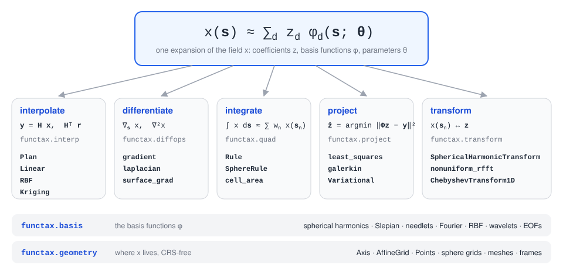
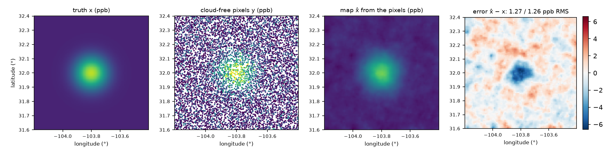
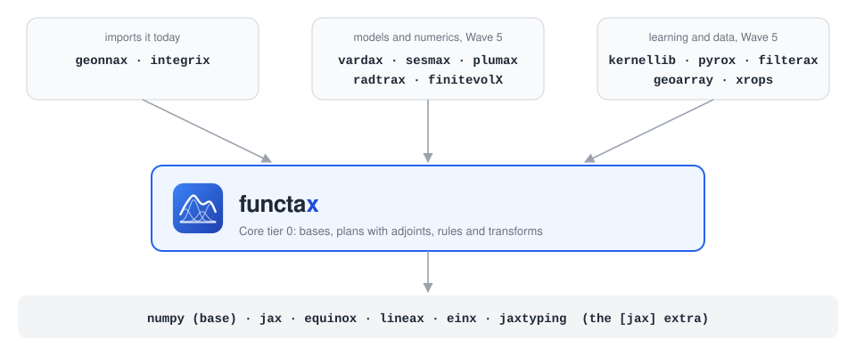
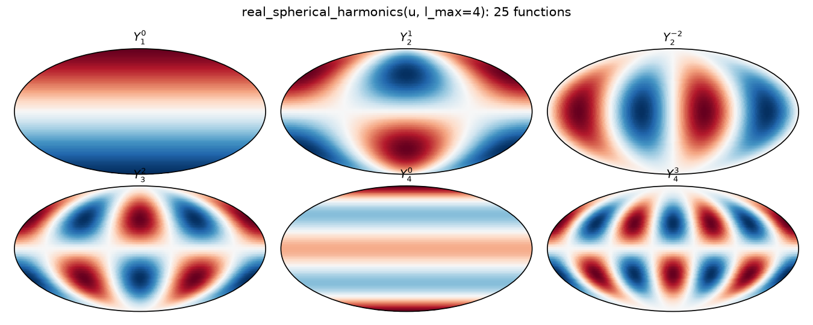
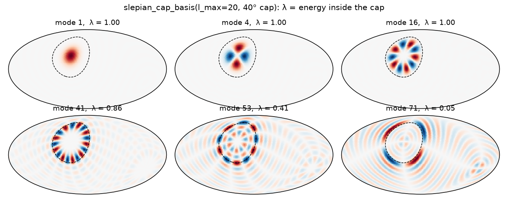
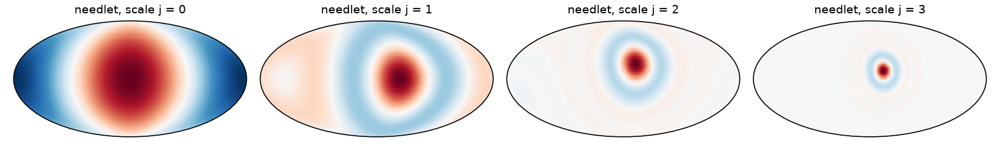

<p align="center">
  <picture>
    <source media="(prefers-color-scheme: dark)" srcset="docs/assets/logo-dark.svg">
    
  </picture>
</p>

<p align="center">
  <a href="https://github.com/jejjohnson/functax/actions/workflows/ci.yml"></a>
  <a href="https://github.com/jejjohnson/functax/actions/workflows/lint.yml"></a>
  <a href="https://github.com/jejjohnson/functax/actions/workflows/typecheck.yml"></a>
  <a href="https://codecov.io/gh/jejjohnson/functax"></a>
  
  <a href="https://opensource.org/licenses/MIT"></a>
</p>

<p align="center">
  <a href="https://jejjohnson.github.io/functax/"><b>Docs</b></a> ·
  <a href="https://jejjohnson.github.io/functax/reference/"><b>API</b></a> ·
  <a href="#example-map-methane-from-one-overpass"><b>Example</b></a> ·
  <a href="#gallery"><b>Gallery</b></a>
</p>

**Function approximation for JAX: bases, interpolation plans with adjoints, quadrature and transforms.**

functax treats a field as a function, which is also where the name comes from (see [The name](#the-name)).
A field $`x(\mathbf{s})`$ over the coordinates $`\mathbf{s} \in \Omega`$ is written as one expansion,

```math
x(\mathbf{s}) \approx \sum_{d=1}^{D_z} z_d \phi_d(\mathbf{s}; \boldsymbol{\theta})
```

where $`\phi_d`$ are the basis functions with parameters $`\boldsymbol{\theta}`$ and $`\mathbf{z} \in \mathbb{R}^{D_z}`$ are the coefficients.
On a set of $`N`$ points $`\mathbf{s}_n`$ this becomes $`\mathbf{x} = \boldsymbol{\Phi} \mathbf{z}`$, with $`\mathbf{x} \in \mathbb{R}^N`$ and the basis matrix $`\boldsymbol{\Phi} \in \mathbb{R}^{N \times D_z}`$, $`[\boldsymbol{\Phi}]_{nd} = \phi_d(\mathbf{s}_n)`$.
Almost everything in the library is one of five operations on this expansion.
We interpolate it, differentiate it, integrate it, project data onto it and transform between its values and its coefficients.
For interpolation, a plan gives us its read-out $`\mathbf{H}`$, the adjoint $`\mathbf{H}^\top`$ and its derivative.
So the same object samples a field at the observations and sends the residuals back to the grid.

We keep functax small and functional.
Building a plan or a rule may run on the host with NumPy, but applying it is pure JAX.
So `jit`, `vmap` and `grad` go through every plan, rule and transform.
We also leave models out of functax, so that it can sit at the bottom of the stack.
A kernel comes in as a callable, a solver as a lineax operator and a difference operator as an argument.

<p align="center">
  <picture>
    <source media="(prefers-color-scheme: dark)" srcset="docs/assets/hero-dark.svg">
    
  </picture>
</p>

## Installation

functax is not on PyPI yet, so install it from GitHub with [uv](https://docs.astral.sh/uv/):

```bash
uv add "functax[jax] @ git+https://github.com/jejjohnson/functax.git"
```

The base install, without `[jax]`, depends on NumPy alone and holds the affine raster kernels in `functax.geometry.affine`.
We did this so that NumPy-only libraries such as geoarray can use them without pulling in JAX.
Everything else needs the `jax` extra (JAX, Equinox, lineax, einx and jaxtyping).
If you import a module that needs it without it, you get a `MissingExtraError` that names `functax[jax]`.

## Quick start

The [quickstart](https://jejjohnson.github.io/functax/quickstart/) runs three of the five operations on one small problem.
We fit the coefficients of a field on the sphere from scattered points, read a grid with a plan and its adjoint, and integrate the fitted field over the sphere.
The example below takes the same operations through the stack's methane overpass.

## Example: map methane from one overpass

The running example of the GeoML stack is one methane overpass: [kernellib](https://github.com/jejjohnson/kernellib#example-map-methane-from-one-overpass) and [pyrox](https://github.com/jejjohnson/pyrox#example-map-methane-from-one-overpass) both map XCH₄ over a 100 × 100 grid in the Permian Basin.
Here we take the same overpass through the three steps a retrieval pipeline needs from functax.
We read the grid at the satellite's pixels, map the field back from those pixels, and integrate what we mapped.

| Symbol | Meaning | Shape, units |
| --- | --- | --- |
| $`\mathbf{s}`$ | a coordinate, (longitude, latitude) | $`\mathbb{R}^2`$, degrees |
| $`\mathbf{x}`$ | XCH₄ at the centres $`\mathbf{s}_n \in \Omega_x`$ of the grid cells | $`\mathbb{R}^{N_{\Omega_x}}`$, ppb |
| $`\mathbf{y}`$ | XCH₄ at the centres $`\mathbf{s}_m \in \Omega_y`$ of the cloud-free pixels | $`\mathbb{R}^{N_{\Omega_y}}`$, ppb |
| $`\boldsymbol{\mu}_x`$ | the background, 1,880 ppb in every cell | $`\mathbb{R}^{N_{\Omega_x}}`$, ppb |
| $`\tilde{\mathbf{x}} = \mathbf{x} - \boldsymbol{\mu}_x`$ | the enhancement over the background | $`\mathbb{R}^{N_{\Omega_x}}`$, ppb |
| $`\boldsymbol{\Sigma}_\varepsilon = \sigma_\varepsilon^2 \mathbf{I}`$ | the pixel noise covariance, $`\sigma_\varepsilon = 8`$ ppb | $`N_{\Omega_y} \times N_{\Omega_y}`$, ppb² |
| $`\mathbf{H}`$ | the plan, from the grid cells to the pixels | $`N_{\Omega_y} \times N_{\Omega_x}`$ |

The grid has $`N_{\Omega_x} = 10{,}000`$ cells, and one overpass leaves 60 % of them cloud-free, $`N_{\Omega_y} = 6{,}017`$ pixels.
Unlike the kernellib and pyrox versions, the pixels do not sit on the grid.
Each pixel centre is up to half a cell away from its cell centre, as a satellite's own footprint would be.
The block below simulates the overpass, a 40 ppb plume with 8 ppb of pixel noise.
For real data, the pixel centres and values of an L2 product drop in for `pixels` and `observations`.

```python
import einx
import jax
import jax.numpy as jnp
import jax.random as jr
import lineax as lx
from functax.geometry import Axis, Points, RectilinearGrid
from functax.interp import Linear, Nearest, Policies
from functax.project import Variational
from functax.quad import cell_area
from jaxtyping import Array, Float

jax.config.update("jax_enable_x64", True)

# Shapes: N_Ωx = 10,000 grid cells (100 lon × 100 lat); N_Ωy cloud-free pixels;
#         N_pair = 19,800 pairs of neighbouring cells

lon = jnp.linspace(-104.2, -103.4, 100)                     # → (100,)  °
lat = jnp.linspace(31.6, 32.4, 100)                         # → (100,)  °
# today (functax)
grid = RectilinearGrid((Axis(lon), Axis(lat)))              # (lon, lat), row-major
lon_cell, lat_cell = jnp.meshgrid(lon, lat, indexing="ij")  # → (100, 100) each
# sₙ = (lonₙ, latₙ), the cell centres
cell_centres = einx.id(                                     # → (N_Ωx, 2)  °
    "a b, a b -> (a b) (1 + 1)", lon_cell, lat_cell
)
background = 1880.0                                         # μ_x → ()  ppb
plume_centre = jnp.array([-103.8, 32.0])                    # s₀ → (2,)  °


# x(s) = μ_x + 40 exp(−‖s − s₀‖² / (2 · 0.08²)),  ppb
def xch4(coords: Float[Array, "*batch dim"]) -> Float[Array, "*batch"]:
    # s − s₀
    offset = einx.subtract("... d, d -> ... d", coords, plume_centre)
    # ‖s − s₀‖²
    distance2 = einx.sum("... [d]", offset**2)
    plume = 40.0 * jnp.exp(-distance2 / (2 * 0.08**2))
    return background + plume


# xₙ = x(sₙ), the truth on the grid
truth = xch4(cell_centres)                                  # (N_Ωx, 2) → (N_Ωx,)  ppb

key_mask, key_noise, key_shift = jr.split(jr.key(0), 3)
# 60 % of the cells are cloud-free
cloud_free = jr.bernoulli(key_mask, 0.6, (10_000,))         # → (N_Ωx,)
spacing = jnp.array([lon[1] - lon[0], lat[1] - lat[0]])     # → (2,)  °
# each pixel centre sits up to half a cell from its cell centre
shift = jr.uniform(                                         # → (N_Ωx, 2)  cells
    key_shift, (10_000, 2), minval=-0.5, maxval=0.5
)
jitter = einx.multiply("n d, d -> n d", shift, spacing)     # → (N_Ωx, 2)  °
# sₘ, the pixel centres
pixels = (cell_centres + jitter)[cloud_free]                # → (N_Ωy, 2)  °
# yₘ = x(sₘ) + εₘ,  εₘ ~ 𝒩(0, 8²)
noise = 8.0 * jr.normal(key_noise, (10_000,))               # → (N_Ωx,)  ppb
observations = xch4(pixels) + noise[cloud_free]             # → (N_Ωy,)  ppb
```

### Stage 1: read the grid at the pixels (`functax.interp`)

Each pixel centre $`\mathbf{s}_m`$ lies somewhere inside a grid cell, not on its centre.
So we need a read-out $`\mathbf{H}`$ that takes the field on the grid to the field at the pixels.
We build it once, as a plan with bilinear weights, so each row of $`\mathbf{H}`$ has four non-zeros (the four cell centres around the pixel).
The same plan gives the adjoint $`\mathbf{H}^\top`$, which sends residuals at the pixels back to the grid.
We check that the two really are transposes of each other with the dot-product test

```math
\langle \mathbf{H} \mathbf{a}, \mathbf{r} \rangle = \langle \mathbf{a}, \mathbf{H}^\top \mathbf{r} \rangle
```

for random $`\mathbf{a} \in \mathbb{R}^{N_{\Omega_x}}`$ and $`\mathbf{r} \in \mathbb{R}^{N_{\Omega_y}}`$.
The usual shortcut is to read each pixel from the centre of its own cell (nearest neighbour).
So we score both against the truth at the pixels.

```python
# today (functax)
# the half-cell border reads its edge cell, so every pixel is valid
edges = Policies(extent="cells", boundary="edge")
# today (functax)
pixel_points = Points(pixels)                                 # → (N_Ωy, 2)  °
# today (functax)
# H, four bilinear taps per pixel
plan = Linear().plan(grid, pixel_points, policies=edges)      # (N_Ωy, N_Ωx) operator
# today (functax)
# H_nn, one tap per pixel (its own cell)
nearest = Nearest().plan(grid, pixel_points, policies=edges)  # (N_Ωy, N_Ωx) operator


# user
# RMS(e) = √(mean eₘ²)
def rms(error: Float[Array, " obs"]) -> float:
    return float(jnp.sqrt(jnp.mean(error**2)))


# x(sₘ), the truth at the pixels
truth_at_pixels = xch4(pixels)                                # (N_Ωy, 2) → (N_Ωy,)  ppb
# H x − x(sₘ)
linear_error = plan(truth) - truth_at_pixels                  # (N_Ωx,) → (N_Ωy,)  ppb
nearest_error = nearest(truth) - truth_at_pixels              # (N_Ωx,) → (N_Ωy,)  ppb
read_rmse = {"linear": rms(linear_error), "nearest": rms(nearest_error)}

# ⟨H a, r⟩ = ⟨a, Hᵀ r⟩ for random a and r
key_a, key_r = jr.split(jr.key(1))
a_random = jr.normal(key_a, (10_000,))                        # → (N_Ωx,)
r_random = jr.normal(key_r, (observations.shape[0],))         # → (N_Ωy,)
forward = plan(a_random) @ r_random                           # → ()
backward = a_random @ plan.adjoint(r_random)                  # → ()
adjoint_gap = float(jnp.abs(forward - backward) / jnp.abs(forward))
```

All 6,017 pixels are valid.
Read from the true field, the bilinear plan is 0.009 ppb RMS from the truth at the pixels and the nearest cell is 0.20 ppb.
Both are well below the 8 ppb of noise here.
This is because the plume's standard deviation is about ten cells, so it is smooth on the scale of one cell.
The dot-product test holds to $`3 \times 10^{-16}`$ relative, so $`\mathbf{H}`$ and $`\mathbf{H}^\top`$ are transposes of each other to rounding.

### Stage 2: map the field from the pixels (`functax.project`)

We now go the other way, from the 6,017 noisy pixels back to all 10,000 cells, including the cloudy ones that no pixel touches.
On its own this is underdetermined, so we add a penalty on how rough the map is and minimise the cost

```math
\mathcal{J}(\tilde{\mathbf{x}}) = (\tilde{\mathbf{y}} - \mathbf{H} \tilde{\mathbf{x}})^\top \boldsymbol{\Sigma}_\varepsilon^{-1} (\tilde{\mathbf{y}} - \mathbf{H} \tilde{\mathbf{x}}) + \beta \Vert \mathbf{L} \tilde{\mathbf{x}} \Vert_2^2
```

where $`\tilde{\mathbf{y}} = \mathbf{y} - \mathbf{H} \boldsymbol{\mu}_x`$ is the enhancement at the pixels and $`\beta \ge 0`$ is the weight of the penalty.
The matrix $`\mathbf{L} \in \mathbb{R}^{N_\text{pair} \times N_{\Omega_x}}`$ takes the differences between neighbouring cells along longitude and latitude.
Setting the gradient to zero gives the normal equations

```math
\left( \mathbf{H}^\top \boldsymbol{\Sigma}_\varepsilon^{-1} \mathbf{H} + \beta \mathbf{L}^\top \mathbf{L} \right) \hat{\tilde{\mathbf{x}}} = \mathbf{H}^\top \boldsymbol{\Sigma}_\varepsilon^{-1} \tilde{\mathbf{y}}
```

which `Variational` solves matrix-free by conjugate gradients, with $`\mathbf{H}`$ applied through the plan from stage 1.
functax keeps no public difference operator (finitevolX and spectraldiffx have them), so we write $`\mathbf{L}`$ here and pass it in as a lineax operator.

```python
# user
# L x = (x_{i+1,j} − x_{ij}, x_{i,j+1} − x_{ij}), along lon and along lat
def differences(field: Float[Array, " cell"]) -> Float[Array, " pair"]:
    image = einx.id("(a b) -> a b", field, a=100)
    # x_{i+1,j} − x_{ij}
    along_lon = image[1:, :] - image[:-1, :]
    # x_{i,j+1} − x_{ij}
    along_lat = image[:, 1:] - image[:, :-1]
    flat_lon = einx.id("a b -> (a b)", along_lon)
    flat_lat = einx.id("a b -> (a b)", along_lat)
    return jnp.concatenate([flat_lon, flat_lat])


cell_vector = jax.ShapeDtypeStruct((10_000,), jnp.float64)
roughness = lx.FunctionLinearOperator(differences, cell_vector)  # (N_pair, N_Ωx) op
# Σ_ε⁻¹ = I / 8²
noise_precision = lx.DiagonalLinearOperator(      # (N_Ωy, N_Ωy) operator
    jnp.full(observations.shape[0], 1.0 / 8.0**2)
)
# today (functax)
# x̃̂ = argmin 𝒥(x̃),  β = 0.1
fit = Variational(                                # (N_Ωy,) → (N_Ωx,)
    plan.operator(), roughness, noise_precision, smoothing_weight=0.1
)
# x̂ = μ_x + x̃̂
enhancement_map = fit(observations - background)  # (N_Ωy,) → (N_Ωx,)  ppb
xch4_map = background + enhancement_map           # → (N_Ωx,)  ppb
map_error = xch4_map - truth                      # → (N_Ωx,)  ppb
observed_rmse = rms(map_error[cloud_free])        # → ()  ppb
cloudy_rmse = rms(map_error[~cloud_free])         # → ()  ppb
```

From pixels with 8 ppb of noise, the map is 1.27 ppb RMS from the truth in the observed cells and 1.26 ppb in the cloudy ones.
The largest errors (up to 6.6 ppb) sit on the peak of the plume, which the roughness penalty flattens.
We picked $`\beta = 0.1`$ out of four values by the error against the truth, which a real overpass does not have.
So take it as a best case.
Over all cells, $`\beta`$ = 0.05, 0.1, 0.2 and 0.5 give 1.4, 1.3, 1.6 and 2.5 ppb.

<p align="center"></p>

### Stage 3: integrate the map (`functax.quad`)

Lastly, we want to know how much methane is in the map, so we integrate the enhancement over the domain,

```math
\int_{\Omega} \tilde{x}(\mathbf{s}) \mathrm{d}\mathbf{s} \approx \sum_{n=1}^{N_{\Omega_x}} w_n \tilde{x}_n
```

where the weight $`w_n`$ is the area of cell $`n`$ on a sphere of radius 6,371 km.
A longitude-latitude cell is not a square on the Earth, and cells shrink towards the poles.
Its area is the radius squared, times its width in longitude (in radians), times the difference of the sines of its two bounding latitudes.
So we take the weights from `cell_area` rather than from a constant pixel size.

```python
# today (functax)
# wₙ = |Cₙ|, the area of cell n on a sphere of radius 6,371 km
area = cell_area(                                      # (N_Ωx, 2), (N_Ωx,)  m²
    grid, sphere_radius=6.371e6, unit="degrees"
)
# ∫ x̃ ds ≈ ∑ₙ wₙ x̃ₙ, for the truth and the map
truth_integral = area.weights @ (truth - background)   # → ()  ppb m²
map_integral = area.weights @ (xch4_map - background)  # → ()  ppb m²
# the same sum over the cloud-free pixels only
pixel_enhancement = observations - background          # → (N_Ωy,)  ppb
pixel_integral = area.weights[cloud_free] @ pixel_enhancement  # → ()  ppb m²
```

The grid covers 6,847 km².
The true plume integrates to 16,866 ppb km², and the map to 17,158 ppb km², which is 1.7 % high.
If we only sum the cloud-free pixels, we get 10,124 ppb km², which is 40 % low, because the cloudy cells hold 40 % of the plume.
The whole example runs in about 10 seconds on a CPU, and [`docs/assets/readme/figures.py`](docs/assets/readme/figures.py) runs its blocks as written, logs these numbers and draws the figures.

## What's inside

Each module links to its API page, and [`docs/api/capabilities.md`](docs/api/capabilities.md) lists every public name in one place.

| Module | Operation | Names |
|---|---|---|
| [`geometry`](https://jejjohnson.github.io/functax/reference/geometry/) | where the coordinates live | `Axis`, `AffineGrid`, `RectilinearGrid`, `CurvilinearGrid`, `Points`; sphere grids (`fibonacci_sphere`, `gauss_legendre_grid`, `latlon_grid`, `healpix_grid`, `icosphere`); frames (`lonlat_to_unit`, `lonlat_to_ecef`, `enu_basis`); the NumPy-only affine kernels in `geometry.affine` |
| [`basis`](https://jejjohnson.github.io/functax/reference/basis/) | the basis functions | `sphere` (real and vector spherical harmonics, needlets), `slepian` (caps, polar gaps, regions), `fourier`, `local` (RBF, Wendland, Gabor, wavelets), `eigen` (EOFs, graph and mesh Laplacians), `polynomial` (Legendre), `vector` (divergence-free and curl-free), `features` (random Fourier, seasonal) |
| [`interp`](https://jejjohnson.github.io/functax/reference/interp/) | interpolate | `Plan` with `adjoint` and `operator()`; `Nearest`, `Linear`, `Cubic`, `BSpline`, `Tensor`; `CubicSpline`, `Pchip`, `Akima`, `Steffen`; `InverseDistance`, `Delaunay`, `Binning`, `Conservative`; `RBF`, `Kriging`; `Fourier`, `Chebyshev` |
| [`diffops`](https://jejjohnson.github.io/functax/reference/diffops/) | differentiate | `gradient`, `divergence`, `curl2d`, `laplacian`, `jacobian_field`; on the sphere, `surface_grad`, `surface_grad_enu` and `laplace_beltrami` |
| [`quad`](https://jejjohnson.github.io/functax/reference/quad/) | integrate | `Rule`, `gauss_legendre`, `clenshaw_curtis`, `trapezoid`, `simpson`; `SphereRule` with `sphere_gauss_legendre`, `sphere_latlon`, `sphere_healpix` and `sphere_fibonacci`; `cell_area`; `polyline` |
| [`project`](https://jejjohnson.github.io/functax/reference/project/) | project | `least_squares`, `galerkin`, `Variational`, `fill_gaps` |
| [`transform`](https://jejjohnson.github.io/functax/reference/transform/) | transform | `SphericalHarmonicTransform`, `nonuniform_rfft`, `nonuniform_irfft`, `ChebyshevTransform1D`, `ChebyshevTransform2D` |

A quadrature rule is only data (the nodes and the weights), and [integrix](https://github.com/jejjohnson/integrix) does the summing, the scanning and the adapting.
The [guides](https://jejjohnson.github.io/functax/) go through interpolation, gridding scattered data, regridding and quadrature in more detail.

## Where it sits

<p align="center">
  <picture>
    <source media="(prefers-color-scheme: dark)" srcset="docs/assets/layers-dark.svg">
    
  </picture>
</p>

functax sits at Core tier 0 of the [GeoStack](https://github.com/jejjohnson/geostack), which means it imports no other library of the stack and any of them may import it.
Today [geonnax](https://github.com/jejjohnson/geonnax) builds its encoders and operators on functax's bases and transforms, and [integrix](https://github.com/jejjohnson/integrix) sums with its rules.
The rest of the stack swaps its own samplers, bases and rules for functax in Wave 5 ([#13](https://github.com/jejjohnson/functax/issues/13)).
We wrote down the design behind all of this on the GeoStack [functax design page](https://github.com/jejjohnson/geostack/blob/main/docs/design/libraries/functax.md).

## The name

functax is named after *functa*.
In "From data to functa", Dupont et al. (2022) proposed that a data point can be treated as a function, stored as the parameters of a neural field.
We can then do deep learning on those functions directly, and in their words, "we refer to the data as functa".
Bauer et al. (2023) then arranged the latent representations spatially (*spatial functa*) and scaled the idea up to ImageNet classification and generation.

We really liked that way of thinking, and functax takes the first half of it.
A field is a function, so we should be able to work with it as one, reading it anywhere, differentiating it, integrating it and projecting onto it.
The neural-field half lives next door in [geonnax](https://github.com/jejjohnson/geonnax), whose coordinate networks are functa in the original sense.

- E. Dupont, H. Kim, S. M. A. Eslami, D. Rezende and D. Rosenbaum. From data to functa: your data point is a function and you can treat it like one. [arXiv:2201.12204](https://arxiv.org/abs/2201.12204), 2022.
- M. Bauer, E. Dupont, A. Brock, D. Rosenbaum, J. R. Schwarz and H. Kim. Spatial functa: scaling functa to ImageNet classification and generation. [arXiv:2302.03130](https://arxiv.org/abs/2302.03130), 2023.

## Gallery

These are some of the bases in `functax.basis`, drawn by [`docs/assets/readme/figures.py`](docs/assets/readme/figures.py).

The real spherical harmonics $`Y_\ell^m`$ are global functions on the sphere; here are six of the 25 with degree $`\ell \le 4`$ (`basis.sphere.real_spherical_harmonics`).

<p align="center"></p>

Slepian functions are regional instead: these are for a 40° cap, ranked by their concentration $`\lambda`$, the share of their energy that sits inside the cap (`basis.slepian.slepian_cap_basis`).
The first few live inside the cap, and past the Shannon number (about 52 here) they leak out of it.

<p align="center"></p>

Needlets are multiscale: here is one centre at four scales, each scale $`j`$ twice as fine as the last (`basis.sphere.needlet_basis`).

<p align="center"></p>

## Related projects

| Project | Role |
|---|---|
| [geonnax](https://github.com/jejjohnson/geonnax) | Networks and neural operators on the plane and the sphere, built on functax's bases |
| [integrix](https://github.com/jejjohnson/integrix) | Integration: sums, scans and adaptive quadrature over functax's rules |
| [gaussx](https://github.com/jejjohnson/gaussx) | Structured linear algebra, solvers and Gaussian primitives |
| [kernellib](https://github.com/jejjohnson/kernellib) | Kernels and scalable kernel methods |

## Development

```bash
git clone https://github.com/jejjohnson/functax.git
cd functax
uv run poe install     # every dependency group + the pre-commit hooks
uv run poe check       # lint, format check, typecheck, tests with the 90 % coverage gate
uv run poe docs        # the MyST prose and the Zensical API reference, assembled into public/
```

`uv run poe` lists every task.
[`AGENTS.md`](AGENTS.md) holds the rules for contributors and coding agents, from the module map and the contracts to the tests that enforce them and the house style.
[`docs/contributing.md`](docs/contributing.md) has the label taxonomy and the epic model.
The icon and the diagrams come from [`docs/assets/render.py`](docs/assets/render.py) (`uv run --no-project python docs/assets/render.py`), and the README figures from [`docs/assets/readme/figures.py`](docs/assets/readme/figures.py), which runs the code blocks above as written.

## License

MIT, see [LICENSE](LICENSE).
