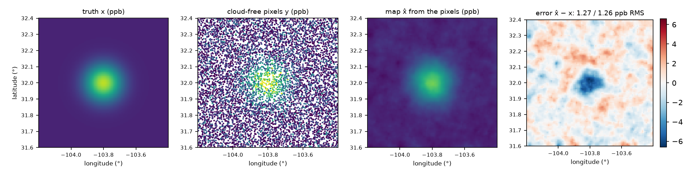

# Map methane from one overpass

The running example of the GeoML stack is one methane overpass: [kernellib](https://github.com/jejjohnson/kernellib#example-map-methane-from-one-overpass) and [pyrox](https://github.com/jejjohnson/pyrox#example-map-methane-from-one-overpass) both map XCH₄ over a 100 × 100 grid in the Permian Basin.
Here we take the same overpass through the three steps a retrieval pipeline needs from functax.
We read the grid at the satellite's pixels, map the field back from those pixels, and integrate what we mapped.

| Symbol | Meaning | Shape, units |
| --- | --- | --- |
| $\vect{s}$ | a coordinate, (longitude, latitude) | $\mathbb{R}^2$, degrees |
| $\vect{x}$ | XCH₄ at the centres $\vect{s}_n \in \Omega_x$ of the grid cells | $\mathbb{R}^{N_{\Omega_x}}$, ppb |
| $\vect{y}$ | XCH₄ at the centres $\vect{s}_m \in \Omega_y$ of the cloud-free pixels | $\mathbb{R}^{N_{\Omega_y}}$, ppb |
| $\gvect{\mu}_x$ | the background, 1,880 ppb in every cell | $\mathbb{R}^{N_{\Omega_x}}$, ppb |
| $\tilde{\vect{x}} = \vect{x} - \gvect{\mu}_x$ | the enhancement over the background | $\mathbb{R}^{N_{\Omega_x}}$, ppb |
| $\gmat{\Sigma}_\varepsilon = \sigma_\varepsilon^2 \mat{I}$ | the pixel noise covariance, $\sigma_\varepsilon = 8$ ppb | $N_{\Omega_y} \times N_{\Omega_y}$, ppb² |
| $\mat{H}$ | the plan, from the grid cells to the pixels | $N_{\Omega_y} \times N_{\Omega_x}$ |

The grid has $N_{\Omega_x} = 10{,}000$ cells, and one overpass leaves 60 % of them cloud-free, $N_{\Omega_y} = 6{,}017$ pixels.
Unlike the kernellib and pyrox versions, the pixels do not sit on the grid.
Each pixel centre is up to half a cell away from its cell centre, as a satellite's own footprint would be.
The block below simulates the overpass, a 40 ppb plume with 8 ppb of pixel noise.
For real data, the pixel centres and values of an L2 product drop in for `pixels` and `observations`.

```python
import einx
import jax
import jax.numpy as jnp
import jax.random as jr
import lineax as lx
from functax.geometry import Axis, Points, RectilinearGrid
from functax.interp import Linear, Nearest, Policies
from functax.project import Variational
from functax.quad import cell_area
from jaxtyping import Array, Float

jax.config.update("jax_enable_x64", True)

# Shapes: N_Ωx = 10,000 grid cells (100 lon × 100 lat); N_Ωy cloud-free pixels;
#         N_pair = 19,800 pairs of neighbouring cells

lon = jnp.linspace(-104.2, -103.4, 100)                     # → (100,)  °
lat = jnp.linspace(31.6, 32.4, 100)                         # → (100,)  °
# today (functax)
grid = RectilinearGrid((Axis(lon), Axis(lat)))              # (lon, lat), row-major
lon_cell, lat_cell = jnp.meshgrid(lon, lat, indexing="ij")  # → (100, 100) each
# sₙ = (lonₙ, latₙ), the cell centres
cell_centres = einx.id(                                     # → (N_Ωx, 2)  °
    "a b, a b -> (a b) (1 + 1)", lon_cell, lat_cell
)
background = 1880.0                                         # μ_x → ()  ppb
plume_centre = jnp.array([-103.8, 32.0])                    # s₀ → (2,)  °


# x(s) = μ_x + 40 exp(−‖s − s₀‖² / (2 · 0.08²)),  ppb
def xch4(coords: Float[Array, "*batch dim"]) -> Float[Array, "*batch"]:
    # s − s₀
    offset = einx.subtract("... d, d -> ... d", coords, plume_centre)
    # ‖s − s₀‖²
    distance2 = einx.sum("... [d]", offset**2)
    plume = 40.0 * jnp.exp(-distance2 / (2 * 0.08**2))
    return background + plume


# xₙ = x(sₙ), the truth on the grid
truth = xch4(cell_centres)                                  # (N_Ωx, 2) → (N_Ωx,)  ppb

key_mask, key_noise, key_shift = jr.split(jr.key(0), 3)
# 60 % of the cells are cloud-free
cloud_free = jr.bernoulli(key_mask, 0.6, (10_000,))         # → (N_Ωx,)
spacing = jnp.array([lon[1] - lon[0], lat[1] - lat[0]])     # → (2,)  °
# each pixel centre sits up to half a cell from its cell centre
shift = jr.uniform(                                         # → (N_Ωx, 2)  cells
    key_shift, (10_000, 2), minval=-0.5, maxval=0.5
)
jitter = einx.multiply("n d, d -> n d", shift, spacing)     # → (N_Ωx, 2)  °
# sₘ, the pixel centres
pixels = (cell_centres + jitter)[cloud_free]                # → (N_Ωy, 2)  °
# yₘ = x(sₘ) + εₘ,  εₘ ~ 𝒩(0, 8²)
noise = 8.0 * jr.normal(key_noise, (10_000,))               # → (N_Ωx,)  ppb
observations = xch4(pixels) + noise[cloud_free]             # → (N_Ωy,)  ppb
```

## Stage 1: read the grid at the pixels (`functax.interp`)

Each pixel centre $\vect{s}_m$ lies somewhere inside a grid cell, not on its centre.
So we need a read-out $\mat{H}$ that takes the field on the grid to the field at the pixels.
We build it once, as a [`Linear`](xref:api#functax.interp.Linear) plan with bilinear weights, so each row of $\mat{H}$ has four non-zeros (the four cell centres around the pixel).
The same plan gives the adjoint $\mat{H}^\top$, which sends residuals at the pixels back to the grid.
We check that the two really are transposes of each other with the dot-product test

$$
\langle \mat{H} \vect{a}, \vect{r} \rangle = \langle \vect{a}, \mat{H}^\top \vect{r} \rangle
$$

for random $\vect{a} \in \mathbb{R}^{N_{\Omega_x}}$ and $\vect{r} \in \mathbb{R}^{N_{\Omega_y}}$.
The usual shortcut is to read each pixel from the centre of its own cell ([`Nearest`](xref:api#functax.interp.Nearest)).
So we score both against the truth at the pixels.

```python
# today (functax)
# the half-cell border reads its edge cell, so every pixel is valid
edges = Policies(extent="cells", boundary="edge")
# today (functax)
pixel_points = Points(pixels)                                 # → (N_Ωy, 2)  °
# today (functax)
# H, four bilinear taps per pixel
plan = Linear().plan(grid, pixel_points, policies=edges)      # (N_Ωy, N_Ωx) operator
# today (functax)
# H_nn, one tap per pixel (its own cell)
nearest = Nearest().plan(grid, pixel_points, policies=edges)  # (N_Ωy, N_Ωx) operator


# user
# RMS(e) = √(mean eₘ²)
def rms(error: Float[Array, " obs"]) -> float:
    return float(jnp.sqrt(jnp.mean(error**2)))


# x(sₘ), the truth at the pixels
truth_at_pixels = xch4(pixels)                                # (N_Ωy, 2) → (N_Ωy,)  ppb
# H x − x(sₘ)
linear_error = plan(truth) - truth_at_pixels                  # (N_Ωx,) → (N_Ωy,)  ppb
nearest_error = nearest(truth) - truth_at_pixels              # (N_Ωx,) → (N_Ωy,)  ppb
read_rmse = {"linear": rms(linear_error), "nearest": rms(nearest_error)}

# ⟨H a, r⟩ = ⟨a, Hᵀ r⟩ for random a and r
key_a, key_r = jr.split(jr.key(1))
a_random = jr.normal(key_a, (10_000,))                        # → (N_Ωx,)
r_random = jr.normal(key_r, (observations.shape[0],))         # → (N_Ωy,)
forward = plan(a_random) @ r_random                           # → ()
backward = a_random @ plan.adjoint(r_random)                  # → ()
adjoint_gap = float(jnp.abs(forward - backward) / jnp.abs(forward))
```

All 6,017 pixels are valid.
Read from the true field, the bilinear plan is 0.009 ppb RMS from the truth at the pixels and the nearest cell is 0.20 ppb.
Both are well below the 8 ppb of noise here.
This is because the plume's standard deviation is about ten cells, so it is smooth on the scale of one cell.
The dot-product test holds to $3 \times 10^{-16}$ relative, so $\mat{H}$ and $\mat{H}^\top$ are transposes of each other to rounding.

## Stage 2: map the field from the pixels (`functax.project`)

We now go the other way, from the 6,017 noisy pixels back to all 10,000 cells, including the cloudy ones that no pixel touches.
On its own this is underdetermined, so we add a penalty on how rough the map is and minimise the cost

$$
\mathcal{J}(\tilde{\vect{x}}) = (\tilde{\vect{y}} - \mat{H} \tilde{\vect{x}})^\top \gmat{\Sigma}_\varepsilon^{-1} (\tilde{\vect{y}} - \mat{H} \tilde{\vect{x}}) + \beta \Vert \mat{L} \tilde{\vect{x}} \Vert_2^2
$$

where $\tilde{\vect{y}} = \vect{y} - \mat{H} \gvect{\mu}_x$ is the enhancement at the pixels and $\beta \ge 0$ is the weight of the penalty.
The matrix $\mat{L} \in \mathbb{R}^{N_\text{pair} \times N_{\Omega_x}}$ takes the differences between neighbouring cells along longitude and latitude.
Setting the gradient to zero gives the normal equations

$$
\left( \mat{H}^\top \gmat{\Sigma}_\varepsilon^{-1} \mat{H} + \beta \mat{L}^\top \mat{L} \right) \hat{\tilde{\vect{x}}} = \mat{H}^\top \gmat{\Sigma}_\varepsilon^{-1} \tilde{\vect{y}}
$$

which [`Variational`](xref:api#functax.project.Variational) solves matrix-free by conjugate gradients, with $\mat{H}$ applied through the plan from stage 1.
functax keeps no public difference operator (finitevolX and spectraldiffx have them), so we write $\mat{L}$ here and pass it in as a lineax operator.

```python
# user
# L x = (x_{i+1,j} − x_{ij}, x_{i,j+1} − x_{ij}), along lon and along lat
def differences(field: Float[Array, " cell"]) -> Float[Array, " pair"]:
    image = einx.id("(a b) -> a b", field, a=100)
    # x_{i+1,j} − x_{ij}
    along_lon = image[1:, :] - image[:-1, :]
    # x_{i,j+1} − x_{ij}
    along_lat = image[:, 1:] - image[:, :-1]
    flat_lon = einx.id("a b -> (a b)", along_lon)
    flat_lat = einx.id("a b -> (a b)", along_lat)
    return jnp.concatenate([flat_lon, flat_lat])


cell_vector = jax.ShapeDtypeStruct((10_000,), jnp.float64)
roughness = lx.FunctionLinearOperator(differences, cell_vector)  # (N_pair, N_Ωx) op
# Σ_ε⁻¹ = I / 8²
noise_precision = lx.DiagonalLinearOperator(      # (N_Ωy, N_Ωy) operator
    jnp.full(observations.shape[0], 1.0 / 8.0**2)
)
# today (functax)
# x̃̂ = argmin 𝒥(x̃),  β = 0.1
fit = Variational(                                # (N_Ωy,) → (N_Ωx,)
    plan.operator(), roughness, noise_precision, smoothing_weight=0.1
)
# x̂ = μ_x + x̃̂
enhancement_map = fit(observations - background)  # (N_Ωy,) → (N_Ωx,)  ppb
xch4_map = background + enhancement_map           # → (N_Ωx,)  ppb
map_error = xch4_map - truth                      # → (N_Ωx,)  ppb
observed_rmse = rms(map_error[cloud_free])        # → ()  ppb
cloudy_rmse = rms(map_error[~cloud_free])         # → ()  ppb
```

From pixels with 8 ppb of noise, the map is 1.27 ppb RMS from the truth in the observed cells and 1.26 ppb in the cloudy ones.
The largest errors (up to 6.6 ppb) sit on the peak of the plume, which the roughness penalty flattens.
We picked $\beta = 0.1$ out of four values by the error against the truth, which a real overpass does not have.
So take it as a best case.
Over all cells, $\beta$ = 0.05, 0.1, 0.2 and 0.5 give 1.4, 1.3, 1.6 and 2.5 ppb.



## Stage 3: integrate the map (`functax.quad`)

Lastly, we want to know how much methane is in the map, so we integrate the enhancement over the domain,

$$
\int_{\Omega} \tilde{x}(\vect{s}) \mathrm{d}\vect{s} \approx \sum_{n=1}^{N_{\Omega_x}} w_n \tilde{x}_n
$$

where the weight $w_n$ is the area of cell $n$ on a sphere of radius 6,371 km.
A longitude-latitude cell is not a square on the Earth, and cells shrink towards the poles.
Its area is the radius squared, times its width in longitude (in radians), times the difference of the sines of its two bounding latitudes.
So we take the weights from [`cell_area`](xref:api#functax.quad.cell_area) rather than from a constant pixel size.

```python
# today (functax)
# wₙ = |Cₙ|, the area of cell n on a sphere of radius 6,371 km
area = cell_area(                                      # (N_Ωx, 2), (N_Ωx,)  m²
    grid, sphere_radius=6.371e6, unit="degrees"
)
# ∫ x̃ ds ≈ ∑ₙ wₙ x̃ₙ, for the truth and the map
truth_integral = area.weights @ (truth - background)   # → ()  ppb m²
map_integral = area.weights @ (xch4_map - background)  # → ()  ppb m²
# the same sum over the cloud-free pixels only
pixel_enhancement = observations - background          # → (N_Ωy,)  ppb
pixel_integral = area.weights[cloud_free] @ pixel_enhancement  # → ()  ppb m²
```

The grid covers 6,847 km².
The true plume integrates to 16,866 ppb km², and the map to 17,158 ppb km², which is 1.7 % high.
If we only sum the cloud-free pixels, we get 10,124 ppb km², which is 40 % low, because the cloudy cells hold 40 % of the plume.
The whole example runs in about 10 seconds on a CPU, and [`docs/assets/readme/figures.py`](https://github.com/jejjohnson/functax/blob/main/docs/assets/readme/figures.py) runs its blocks as written, logs these numbers and draws the figure.
